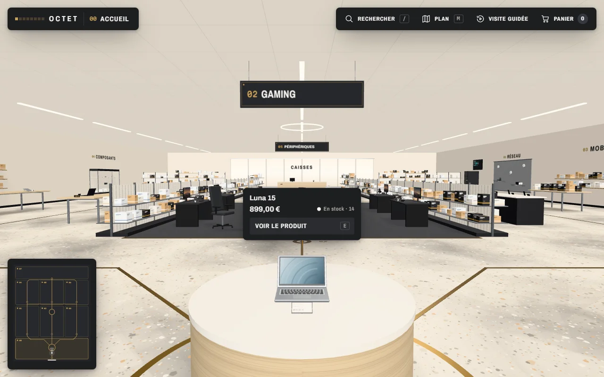

# OCTET — magasin informatique en 3D

Une boutique qu'on visite à pied, dans le navigateur. On entre depuis la rue, on parcourt les rayons, on regarde les produits de près, on ouvre leur fiche et on remplit son panier.



> **Catalogue de démonstration.** Les produits, les prix et les stocks sont fictifs. Le paiement en ligne n'existe pas : le panier s'arrête avant la commande.

## Ce qu'on y trouve

- **Huit zones**, une par bit de l'octet du logo : accueil, PC portables, gaming, mobile & image, composants, périphériques, réseau, caisses.
- **38 produits** posés sur des tables, vitrines, gondoles, bureaux et baies, avec une étiquette quand on s'en approche et une fiche détaillée.
- **Recherche, plan du magasin, visite guidée et panier** (gardé dans le navigateur).
- **Tout est dessiné en code** : meubles, produits, écrans et affiches sont construits avec three.js et des textures canvas. Aucune image ni modèle 3D à télécharger.
- **Qualité adaptée à l'appareil** : résolution et ombres s'ajustent, commandes tactiles sur téléphone.

## Lancer en local

Il faut [Node.js](https://nodejs.org/) 22.12 ou plus récent.

```bash
npm install
npm run dev
```

Puis ouvrir http://localhost:4400.

| Commande          | Rôle                                         |
| ----------------- | -------------------------------------------- |
| `npm run dev`     | serveur de développement (port 4400)         |
| `npm run build`   | site statique dans `dist/`                   |
| `npm run preview` | sert `dist/` pour vérifier la version finale |

Le résultat de `npm run build` est un site statique : il se publie tel quel sur n'importe quel hébergeur de fichiers (GitHub Pages, Netlify, etc.).

## Commandes

| Action              | Ordinateur                                    | Téléphone                     |
| ------------------- | --------------------------------------------- | ----------------------------- |
| Regarder            | glisser la souris                             | glisser un doigt              |
| Marcher             | `Z` `Q` `S` `D`, `W` `A` `S` `D` ou flèches   | manette en bas de l'écran     |
| Aller à un endroit  | cliquer au sol                                | toucher le sol                |
| Ouvrir un produit   | cliquer dessus, ou `E` quand il est en vue    | le toucher                    |
| Rechercher          | `/` ou `Ctrl` + `K`                           | bouton Rechercher             |
| Plan du magasin     | `M`                                           | bouton Plan                   |
| Fermer un panneau   | `Échap`                                       | bouton de fermeture           |

## Liens directs

- `?produit=<id>` ouvre la fiche d'un produit, face à lui : `/?produit=luna-15`
- `?rayon=<zone>` place le visiteur dans un rayon : `/?rayon=gaming`

Les identifiants sont ceux de `src/data/catalog.js`.

## Organisation du code

```
src/
  data/catalog.js          le catalogue : magasin, zones, produits, prix, stocks
  pages/index.astro        la page
  components/              l'interface HTML par-dessus la 3D (barre, panneaux, plan)
  scripts/store/
    main.js                démarrage et boucle de rendu
    layout.js              où chaque meuble et chaque produit est posé
    models.js              les modèles 3D des produits
    fixtures.js            le mobilier (tables, vitrines, gondoles…)
    architecture.js        les murs, la façade, l'éclairage, la signalétique
    screens.js             les écrans et terminaux animés, l'affiche de l'accueil
    textures.js            les textures dessinées en canvas
    nav.js                 les déplacements et les collisions
    focus.js               le produit en vue
    hud.js                 la fiche produit, le panier, la recherche, le plan
    cart.js                le panier
    quality.js             le niveau de qualité selon l'appareil
  styles/                  polices, couleurs, interface
public/fonts/              polices hébergées avec le site
```

## Ajouter un produit

1. Ajouter une entrée dans `products` (`src/data/catalog.js`) : identifiant, zone, référence, nom, prix, stock, accroche, description et caractéristiques.
2. Lui donner un modèle dans `builders` (`src/scripts/store/models.js`), en réutilisant un modèle existant ou en en construisant un.
3. Le poser dans la salle avec `product(...)` (`src/scripts/store/layout.js`).

Une photo peut s'afficher dans la fiche : placer l'image dans `public/produits/` et renseigner `photo: '/produits/nom.webp'`. N'utilisez que des images dont vous détenez les droits.

## Technologies

- [Astro](https://astro.build/) pour la page et la compilation
- [three.js](https://threejs.org/) pour la 3D
- Polices [Archivo](https://github.com/Omnibus-Type/Archivo), [Archivo Narrow](https://github.com/Omnibus-Type/ArchivoNarrow) et [Martian Mono](https://github.com/evilmartians/mono)

## Licence

Le code est publié sous licence [MIT](LICENSE).
Les polices de `public/fonts/` restent sous leur propre licence, la [SIL Open Font License 1.1](public/fonts/OFL.txt).
